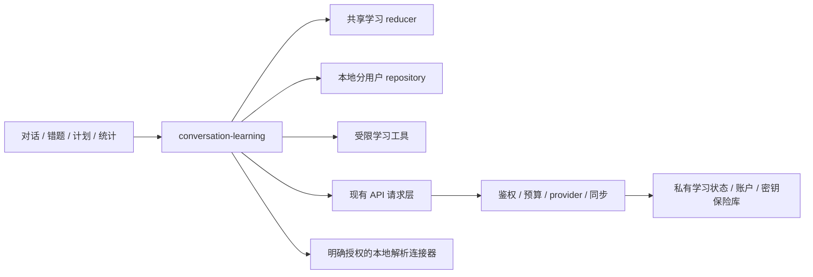

# 系统架构

沿用 Vue 3 / uni-app + Pinia → Service/API → Laf 函数；独立运行由 Express / MongoDB 适配，资料解析使用隔离 Python 工具。不新增微服务、多智能体平台或公共插件市场。

教学后续观察通过共享只读learning-teaching-observation从已有教学收据、消息、尝试、题关系和调度重算；Store、统计与progress工具读取同一函数。它不另存效果评分或新事件流，也不由模型重猜统计；自动方法选择与持续用户意愿在原Store/工具层执行，更正继续由共享reducer撤销过期判断。

## 单一事实

纯学习 reducer 在 laf-backend/functions/\_shared/learning-domain.js，客户端仅重导出。作答、判分、计划、复习和工具收据是显式事件，不由模型从聊天猜统计。Repository 按当前用户命名空间读写，写入前保存恢复副本。H5 Web Locks 限制单写者；不支持的端显示单窗口边界。

云同步上传明确授权的操作，服务端再验证答案权威，CAS 最多重试 5 次。同标识异内容冲突保存本机/云端双方，用户可导出、重新拉取校验后采用云端、或恢复冲突时本机副本；不自动合并冲突作答。取消、删除、恢复和账户切换都检查归属及生命周期，旧响应不能覆盖新状态。

退出登录保留该用户本机学习命名空间，先落盘延迟写入，再清理身份、连接令牌和缓存。登录不会自动接管访客记录；预览→明确确认→重放事实→保存恢复前副本，访客原件保留，不自动上传。普通备份仍拒绝跨账户恢复。

## 执行和预算

learning-tools 管理名称/版本/权限/前置条件/预算/超时/取消/幂等；模型输出先解析、白名单和业务校验再写入。provider 独立于学习记录。平台实际成本与用户权益分账，未知成本待结算，默认平台预算和支付关闭。

公网云代理固定解析后的公网 HTTPS 地址，拒绝内网/环回/元数据及重定向绕过。本地模型连接器与公网代理分开，使用数值私有地址白名单、鉴权、精确来源和会话硬预算；能力不足不静默上传。Node 文本模型连接器与 Python 资料解析器独立配置和授权，后者不再提供模型转发。

PWA 应用壳只处理根路径与 index.html 的 uni-app 哈希路由，避免吞掉独立 HTML/服务路径；私人 API 响应不进入公共缓存。刷新保留本机事实，不能用缓存的旧模型消息代替当前工具状态。

## 兼容与取舍

保留旧题库、study-engine、本地学习键和 FSRS 调度。子包 FSRS 副本为包体边界而保留，并审计一致。旧首页/对战入口兼容，但停止无证据的游戏化扩展；聊天主流程使用 learning-shell。旧 pdf2flashcard-v2 管线不恢复为生产解析中心，必要来源/质量模块继续复用。退役 provider-factory 与 lafService 不重新接回业务。

静态审计覆盖全仓自产源码；自动导入图不覆盖所有动态注册，零入边不作为自动删除证据。模块位置见[03](03-MODULE-INDEX.md)。

## 有界长历史

逻辑状态仍为v1，保留旧键和原始JSON兼容；超过12万字符的本机状态按不可变分页保存，全部页面写入成功后才切换manifest。恢复/迁移/冲突副本共用相同内容页面；目录与无正文写入日志支持清理中断重试，清理只处理当前账户已登记且不被任何有效head引用的页面。H5只读窗口不清理写者正在准备的页面。隐私删除清理所有副本及退役分页，整本机删除覆盖登记分页；下载文件和其他设备另行处理。

同步服务复用单个learning_states文档和revision CAS，大状态使用Node内置gzip封装，旧raw可读；不新增分页集合、多文档提交或缓存旧服务端版本。客户端按固定revision/generation分批读取120000字符页面，每次最多3页，拒绝混合版本；push只取确认，最后重新读取服务端事实。每次同步最多512请求/10分钟，客户端每61秒最多24请求，服务端30次/分钟门禁保持。取消不撤销已接收批次，重连幂等补传。

当前硬边界为逻辑状态600万UTF-16字符/2万操作；恢复预览每批最多20操作且不超过140万字符，最长120秒，可取消，全部验证完成并再次检查归属/版本后才允许合并。页面只挂载50条消息；仍完整加载逻辑状态并重算，没有实现无限归档或冷存储，实际设备空间/内存/延迟可更早成为边界。达到限制时拒绝新增写入并如实显示，不丢弃旧事实以继续生成。

没有新增运行依赖。Node22.22.3内置[zlib文档](https://raw.githubusercontent.com/nodejs/node/v22.22.3/doc/api/zlib.md)用于压缩/解压输出限制；[MongoDB文档](https://www.mongodb.com/docs/manual/reference/limits/)规定BSON文档16MiB上限。实现将压缩输出限定8MiB，Base64约10.7MiB，解压输出最多2400万字节并再验逻辑上限。gzip和校验摘要均不是加密或权限证明；归属、鉴权、CAS和业务重放独立验证。维护与验证沿用本项目规范，浏览器/微信/App共享纯JS分页，Node压缩仅在后端；构建不代替设备验收。

本轮移除无调用方的 favorite.api.js 客户端包装（157 行）；收藏使用现有 question-favorite 模块，后端 favorite-manager 与安全冒烟保留。easycom 注册的离线提示和公共开关组件不因静态导入图零入边删除。

## 有界精确代数

`safe-algebra-v1` 是项目自研纯 JavaScript 模块，无新增运行依赖。它解析限定语法为精确分数系数的多项式/有理式，通过交叉相乘后的系数恒等验证等价性；方程用一次/二次有理根公式、原分母限制和精确代回验证。采样相等不作为恒等证据，模型 reference 不参与答案建立。题干必须完整匹配公开任务语法，附加条件、不可解析语法或关键识别歧义保留待核对。

选择理由：现有数值/单位/解集工具保留，新模块填补符号与原定义域缺口，不重写 provider 或引入 CAS 服务。许可沿用仓库 `UNLICENSED` 标识，不把自研代码宣称为开源第三方许可。维护由本项目测试集和兼容合同负责；字符256、token128、嵌套16、幂指数绝对值6、多项式次数6、约分后分数分子绝对值/分母10亿，并检查所有中间安全整数。没有 BigInt、动态代码、系统调用、网络、临时文件或额外付费资源。构建跨端复用不代替旧设备运行验证。

候选评估：未引入 SymPy。官方 [parse_expr 文档](https://docs.sympy.org/latest/modules/parsing.html) 明确提醒该接口会求值，不适合直接处理不可信输入；另起 Python CAS 服务也增加跨端、部署与资源边界。精确分数的独立核对使用已有 Python 标准库 [fractions](https://docs.python.org/3/library/fractions.html)，不调用文本求值接口、不新增生产依赖。自研工具只支持公开的有限语法；超出范围不能借候选组件名称伪装可靠核验。

## 流式教学执行边界

`proxy-ai`与`proxy-ai-stream`共用runLearningModelTask：鉴权/输入/上下文/能力→幂等预算预留→取消状态检查→指定HTTPS上游→完整输出验证→成本结算→客户端业务工具。SSE不是另一套学习状态或费用账；共享reducer仍是唯一事实与统计来源。纯JS UTF8/SSE codec不引入运行依赖，不执行代码。Node使用既有HTTPS/DNS/TLS和内置AbortController；公有DNS检查、固定socket地址、不跟随重定向保持。

后端每个执行器按owner/requestId独立隔离，最多128个进程内在途任务，数据库取消检查每500ms顺序进行、无重叠；多实例通过原成本账确认取消。响应通过AsyncLocalStorage绑定请求，移除全局response回退，避免并发流串线。客户端断开/取消或无法确认账本时停止新增输出；已经产生的供应商费用如实待结算。

H5 fetch Reader及微信原生RequestTask分块各自适配；当前App明确不支持此传输。start/preview/result/error有版本和严格顺序，预览只在内存且只提取教学message，完整EOF前不能落工具/题目/教学事实。恢复读取相同用户原请求结果，未调用模型；历史导入的请求意图只作历史，不授权恢复执行。
