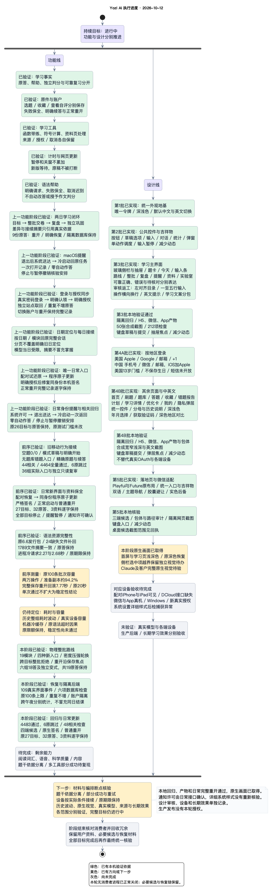

# 开发计划

本文只保留当前计划：范围与交付顺序、已采用的关键决定、A—E 批次、完整交付核对矩阵、最近一次阶段汇报和汇报约定。逐阶段的历史汇报与验收细节见 [12 变更记录](12-CHANGELOG.md) 和 git 历史（2026-10-10 精简前的完整版本见提交 `77093a22`）。

## 2026-10-10：对话学习路线与整批训练执行计划

客户已接受基于[ChatGPT 分享对话](https://chatgpt.com/share/6aca1dfe-3a78-83ea-9e9b-ab24ebafd15d)的十一项优化，并要求先写计划，再持续实施到学习闭环。本文是本轮唯一计划，不另建根级说明或重复待办报告。计划先于业务代码落地，下面只按实际验证更新本机范围；完整设计、其他设备、真实模型语义和长期效果分别保留。

### 目标与闭环标准

用户能够明确保存学习目标与节奏，查看今日模块路线，集中完成题组并一次交卷，取得与原答绑定的统一反馈，完成模块/日终复盘，确认下一批训练与到期复习，在支持的终端设置、修改、取消提醒，并从提醒回到原任务明确作答。普通重开、备份恢复和已授权同步后，目标、题序、原答、停止、完成依据与提醒状态保持一致。

“当前第几天”“已完成几天”“已经提交”“可靠判分”“独立复测通过”分别表达。题目和统计仍来自已有共享事实；小样本、提示后正确、主观辅助反馈和活动次数不升级为长期掌握或正式考试分数。

### 范围、收益与成本

沿现有页面/组件 → Store → Service → 共享后端合同实施，复用已支持的原创数学、写作、词句、科学及私人材料单元，保留 Playful/Future 构图、紫蓝品牌、Wot/现有字体与可访问性。收益是减少搬运成绩、逐题确认和查找下一任务的负担；成本是增加有界学习路线/题组合同、对应视图与恢复/同步回归。先复用现有依赖和系统能力；确需新的外部工具、运行依赖或通知服务时，另说明收益与维护成本并取得同意。

本轮本地功能实现不授权收费、生产部署或真实用户数据迁移。公共题源门禁保留，分享页题目/分数不导入用户记录或公共库。已有 `tests/unit/learning-history.spec.js` 未提交修改保全。功能与视觉分别验收，设备/站外送达、真实模型语义和长期效果不由源码或构建推定。

客户已进一步选择采用系统原生定时通知。官方Tauri桌面通知实现会忽略调度参数，因此macOS沿系统UserNotifications建立受限桥，由系统保存定时请求；网页保留明确授权的应用内通知。原生桥只接收有界提醒与固定学习返回信息，不提供任意命令、URL或正文执行能力；关闭应用后的实际送达及其他平台分别验收。

客户随后提供[最新Day 2结课对话](https://chatgpt.com/share/6aca4b80-6900-83ea-a27d-7618b6da1e4c)，追加吸收日间/分项差异卡、集中薄弱点巩固卡和接续档案：先呈现两轮原答样本、提示经历、题量/模式/建议时长和待核对，再解释训练记录差异；不从不同自编题推出能力升降。可靠错答、部分正确、提示后成功与主观待核对分开组织，巩固按钮绑定原题/证据，并实际创建独立检验任务。后续题量可修改，接续摘要只投影当前目标的真实记录和明确偏好，不复制分享页成绩或把AI主观评价提升为掌握事实。新内容并入阶段3，阶段4—5继续独立完成。

随后要求同一目标按日期/模块定位完整会话，模型只接收当日受限正文及同目标接续依据；每日进度嵌入对话，精简重复标题/角色标签并优化首页Yozi AI字形。已沿现有实现完成并有限验收，完整保存、明确作答和停止保持，未增加依赖或新计划。唯一日常入口程序更新、配对恢复、正常重开与相关回归通过；后经客户明确授权修复同身份本机签名，日常identity实际许可、退出送达、冷启动一次返回和停止撤销均已验，其他设备继续分列。

### 分阶段工作与十一项对应

| 阶段         | 交付与原清单对应                                                  | 当前验证与剩余范围                                                                                          | 当前状态     |
| ------------ | ----------------------------------------------------------------- | ----------------------------------------------------------------------------------------------------------- | ------------ |
| 1 目标与呈现 | 01目标/今日路线、03结构化卡片、04范围一致统计                     | 保存/重开/恢复、分母与范围通过；网页宽窄/浅深/键盘/减少动态通过，完整设计与其他设备待验                     | 本机已验     |
| 2 模块与整批 | 02节奏/一次交卷、05模块、06错答卡                                 | 有界19模块、跨目标原子拒绝及保存焦点重开通过；新增六物理模块实操，不扩大为全课程质量                        | 本机已验     |
| 3 复盘与后续 | 07复盘、08证据调整、10既有可视化、11路线/日历；Day2差异/巩固/接续 | 两完成日、双方分母、待核对、实际独立变式、可改后续和事实摘要通过；自然长期跨天/教学效果待验                 | 本机已验     |
| 4 提醒       | 09修改/暂停/去重/真实状态/原任务                                  | 独立与日常macOS身份均实际退出送达/冷启动一次返回；日常原事实保持、停止撤销通过；其他平台待验                | 日常Mac已验  |
| 5 闭环与收口 | 十一项接续、恢复/同步、构建/审计、资源收尾                        | 两日9原答/真实登录/明确授权同步保持；日期定位、8文件241项与6文件176项、日常更新/签名/正常重开通过；设备继续 | 本机阶段通过 |

### 验证与完成规则

1. 用已有 Vitest/固定规则构造隔离任务验证目标日期、统计范围、题组全量校验、原答/帮助、稳定编号、计划版本、取消/迟到结果和旧事件兼容；不访问真实用户数据或未经授权的模型。
2. 运行受影响前后端检查、H5/微信/App 构建与产物审计；检查脚本副作用后执行，复用既有输出位置，不启动重复全套环境。
3. 浏览器实际走完一条可独立判分的完整学习路线，追加主观待核对、未答/失败重试、停止、重开和备份恢复；统计、卡片及原答与事实逐项对照。真实后端与原生候选沿既有受保护隔离入口验收。
4. 提醒至少分别记录设置成功、到期触发、平台接纳、真实送达与点击返回；不把页内提示或API返回冒充关闭应用后的系统通知。平台申请/权限/设备实际不可用只阻塞对应验收，其余工作继续。
5. 同步受影响的01/03/04/05/06/07合同、12变更、本计划与既有PlantUML进度图；每个独立阶段用业务语言汇报结果、依据和剩余项。完成矩阵保留未验证项，完整目标未满足时继续进行，不以测试数量或构建全绿替代闭环。

## 最新阶段的费曼汇报：物理路线与重开接续

学习者现在可以从路线进入恒定合力、初速度与分段运动、速度—时间图、功与动能，并集中交卷。密度和压强不再只重复一种求解目标；沿原固定规则给出反馈，原答、提示经历与待核对仍各自保存。题目范围有界，模块多了不等于全课程质量或长期掌握已经通过。

实际训练又暴露出两处断点：科学题能被另一目标绑定，重开时旧批次遮住已经保存的独立变式。现在前者整批拒绝，后者按保存的当前题继续显示，明确旧日定位仍优先，停止没有被解除。网页实际交了六组18答，再从错答进入独立变式明确作答；合计19原答、109事件，正常重开与三次公开导出逐字保持。过程跨真实午夜，统计按前日13答、次日6答保留，未把六组提交算成同日结课。

日常电脑程序也沿唯一入口更新并普通退出重开。查看新增模块后取消草稿，27个原目标、32份原答、3份资料及全部题目、计划、复习逐字保持；目标仍停止，提醒仍暂停。程序回滚与资料试还原先核验，当前只保留签名归档及必要配对恢复材料。

本阶段软件范围通过：4483项回归与48项相关检查、四端前端和离线原生构建、实际网页与隔离真实数据库通过，独立只读复核接受修复。App连接器预检确认配对设备可见，但原生SDK接口未配置，尚未装配插件；Windows、微信/App设备、真实模型、题源、完整视觉与生产仍分别待验。本次临时回放误触发环境加载和失败断言的私有正文日志均已纠正，具体边界记在变更与回执中。

下一步先验证材料的题干与答案依据分离，以及一轮多工具中部分成功、后续失败时的真实回执和重复请求；这两项目前是待复现检查点，不能提前宣称有缺陷或已修复。沿现有实现继续，不增加框架；设备只执行已具备条件的范围，完整目标保持进行中。前序语法资源已补全，历史耗时波动仍待因果定位，不放宽原期限。

依据见[本阶段变更](12-CHANGELOG.md#2026-10-12物理整批路线归属与重开接续)、[现有回执](../tmp/stage1-mobile-20261011/verification.md)、[当前产物与恢复映射](08C-SCRIPTS-REFERENCE.md#当前候选与本机资源)和[设计规则](07-STYLING-SYSTEM.md)。功能、设计、设备及长期效果分别收证，整体闭环尚未完成。

## 范围与交付顺序（客户 2026-10-01 确认）

产品保持通用学习定位，重点覆盖小学、初中、高中、考研、考公、雅思和托福。平台能力来自共享学习事实、材料来源、受限工具、独立判分和复习反馈；不以更换提示词或接入强模型代替垂类能力。

交付顺序：网页 → macOS/Windows → 微信小程序 → 手机应用。10月01日时桌面安装包尚未实现；10月02日已采用 Tauri 并完成上述 macOS arm64 本机安装范围，Windows 仍待验，不把 H5/PWA 或 uni-app 源码构建称为安装验收。客户已选择主网页 Playful Idea、桌面 Future 3D Portfolio（小程序参考）；提示词来源 https://wangshiliang.cn/news 。原模板先忠实构建，再替换为 Yozi AI 品牌并接现有功能；设计合同见07。

真实模型验收使用本机私有免费模型目录，优先沿已有受保护入口、合成学习任务和有界调用。客户不安排人工核对：自动验收采用独立标准答案或确定性规则；主观语义、口语发音及长期教学效果继续标记未验证，其他模型的同意不升级为可靠判分。

1. 第一阶段（偿债，小至中）：保留交接源码版本和既有暂存；修复跨账户请求共用、取消和迟到结果；修正打包误报和异常收尾；完成原件登记整理/定位恢复的实际网页验收。
2. 第二阶段（共用垂类底座，中）：复用现有学习策略、工具和模型连接；明确学习方向、年级/考试版本、任务目标、材料和可验证能力。分别记录无材料/缺答案/工具不支持，不自动猜教材、试卷年份或官方评分。用同一固定任务比较多个模型的结构成功、工具执行、引用、独立判分、取消和重复请求。
3. 第三阶段（纵向能力，中至大）：先小学算术与初高中代数、考研现有合法材料，再考公数量/资料分析与英语阅读；之后推进申论、作文、听说。每条路径交付材料→原答→校验/辅助反馈→诊断→独立复测，不把七个方向名称当作七套已验收功能。已有题源门禁继续阻塞公共库发布。
4. 第四阶段（桌面，中）：Tauri 2 已获客户采用，macOS 本机包/文件/学习恢复已验；继续 Windows 安装、真实账户/模型连接与签名发布条件。复用服务与事实；更新继续保留应用标识及用户数据，当前没有后台自动更新权限。采用其他新框架或辅助组件前说明收益和维护成本并取得用户同意。
5. 第五阶段（移动，大）：依次微信、手机；复用已有适配，逐项验收真实授权、登录、网络、文件和设备，保留包体及受保护发布边界。

## 已采用的关键决定

总体执行顺序为“统一合同 → 高价值接入 → 能力扩展 → 系统整合”，本轮路线与整批训练沿顶部执行计划推进，设计范围见[07](07-STYLING-SYSTEM.md)。长期真实学习效果单独验收，不阻塞软件工程开发；功能、界面、设备与生产验收分别成立。

### 桌面宿主已采用：Tauri 2

客户于 2026-10-02 明确“采用并继续”，已采用 Tauri 2 的 macOS/Windows 宿主，复用现有 Vue/uni-app H5 产物与学习事实，默认 Future 外观；文件、凭据与连接器沿既有逐次授权及受保护接口，不给网页任意文件/命令权限，不加载远程页面到特权窗口。macOS arm64 App/DMG 已完成本机隔离安装；Windows 继续独立构建/安装验收。开发者签名、公证、商店、收费及生产发布另按原授权门禁。

收益是沿现有前端实现、使用系统 WebView，减少另维护一套页面；成本是引入 Rust/Tauri 依赖和两端原生打包维护，Windows 需要 C++ Build Tools 与 WebView2，本机 Rust 1.93.1 已就绪。依据为 [Tauri 架构](https://v2.tauri.app/start/)与[官方构建前提](https://v2.tauri.app/start/prerequisites/)。CLI/API 锁定 2.12.1，Rust 依赖保留 Cargo.lock；四个脚本已接入 package.json，操作说明见[08C](08C-SCRIPTS-REFERENCE.md)。当前日常包为本机 arm64 构建，经明确授权补齐同身份ad-hoc签名并严格核验，未开发者签名/公证。

### 开源调研与采用判断

以下仅确认公开说明和许可信息，未安装、未运行或导入上游代码/数据；采用判断是建议，不代表质量验收。当前不新增依赖，不直接修改上游。正式复用时保留上游归属，自定义适配独立存放；先更新上游再应用适配，安全修复和结构冲突单独评估。

| 覆盖               | 核对来源                                                                                                                                                                           | 适用点与限制                                                                                                             | 本轮决定                                                             |
| ------------------ | ---------------------------------------------------------------------------------------------------------------------------------------------------------------------------------- | ------------------------------------------------------------------------------------------------------------------------ | -------------------------------------------------------------------- |
| 平台底座           | [Codex](https://github.com/openai/codex)、[Kolibri](https://github.com/learningequality/kolibri)                                                                                   | 工具/上下文与教育内容组织；独立平台许可不等于所载教材许可，也不证明学习效果                                              | 借鉴职责边界，保留已有架构，不引入整套平台                           |
| 小学               | [中国小学数学知识图谱](https://github.com/wwlwgo/cn-primary-math-knowledge-graph)、[数据许可](https://github.com/wwlwgo/cn-primary-math-knowledge-graph/blob/main/DATA_LICENSE.md) | 稳定能力标识/来源映射；当前依赖明确为soft候选。代码MIT，数据库ODbL、自有文字CC BY-SA；许可文档与候选版本对应关系仍待确认 | 作为知识组织候选，不把候选先修当必需关系，不导入教材/题目            |
| 初中/高中/考研数学 | [MATH](https://github.com/hendrycks/math)、[Math-Verify](https://github.com/huggingface/Math-Verify)                                                                               | 数学固定评测、答案解析/等价校验；竞赛题不等于中国课标或考研真题，解析成功不证明推理正确，复杂输入需资源隔离              | 保留已有有界精确规则，研究扩充独立评测；不引入通用执行器             |
| 考公               | [考公AI导师](https://github.com/KeWang0622/kaogong-skill)                                                                                                                          | 行测/申论题型和出处分工；政策/格式必须核对当年官方信息，模拟题不能称真题，评分语义仍待验                                 | 借鉴任务分工，复用已有资料/原答/辅助评分，不照搬题库                 |
| 雅思/托福          | [English Exam Coach](https://github.com/OleksiiDotsenko/english-exam-coach)                                                                                                        | 任务类型、原答改写、独立复测与进度；明确非官方估分，考试格式按年度更新，文字转录不证明听说能力                           | 先英语阅读/词汇和有来源反馈，再作文/听说；考试格式实施前核对官方版本 |
| 跨方向复习         | [ts-fsrs](https://github.com/open-spaced-repetition/ts-fsrs)                                                                                                                       | 项目已有FSRS；调度规则不能代替可靠作答依据或长期效果证明                                                                 | 继续复用，不重复实现第二套调度                                       |

## A—E 批次

按用户确定的 A—E 规划继续实施。每批交付一条可运行路径，同时记录安全、费用和数据一致性；不为形式重复已有模块。外部阻塞只影响对应验收。

| 批次             | 已有本地实现                                                                     | 后续重点 / 外部条件                                            |
| ---------------- | -------------------------------------------------------------------------------- | -------------------------------------------------------------- |
| A 基线与对话     | 审计、兼容reducer/repository、工具、作答/统计/预算、有界长历史及本机两万操作容量 | 真实用户规模、设备容量与长期冷归档                             |
| B 材料与质量     | 文本、分段 PDF/印刷图连接器、角色/来源/不确定、争议更正、有限变式                | 真实手写/含图评测、移动原生OCR桥和设备能力                     |
| C 教学与复习     | 可修正自述/节奏、方法保护、实际教学后续观察、换法、有效 FSRS 调度                | 更广独立题型验证、长期复测与策略效果校准                       |
| D 模型与商业基础 | provider、BYOK、连接器、能力差异、分账预算、周权益和订阅沙箱                     | 真实本地可达性、视觉/供应商流式与端验、价格/支付授权和渠道资格 |
| E 连续交付       | 同步、迁移/回滚、多端构建、备份/访客分批校验、冲突双方及版本分页处理             | 实际规模/设备、独立生产回退/公开发布                           |

## 完整交付核对矩阵

下表按最初需求逐项核对，避免把“本地功能候选”提前标成目标完成。隔离测试、真实服务、设备与公开发布分别记录；真实价格和权限未定项保留可配置/关闭，不据此停止其余实现。

| 需求范围          | 当前实现/证据                                                                                                                                                                                                                                                                                      | 仍需完成                                                                                                                                                              |
| ----------------- | -------------------------------------------------------------------------------------------------------------------------------------------------------------------------------------------------------------------------------------------------------------------------------------------------- | --------------------------------------------------------------------------------------------------------------------------------------------------------------------- |
| 产品定位/免费边界 | 对话为主、BYOK/本地与平台权益分账；核心记录/错题/计划不受会员门禁                                                                                                                                                                                                                                  | 当前平台模型服务及生产额度规则未开放；不代订正式价格                                                                                                                  |
| 仓库审计/复用     | 既有工作树与暂存区保全、统一 reducer、旧答题/FSRS/质量工具复用、文档索引21份                                                                                                                                                                                                                       | 后续每批扫描增量；依赖安全按当前全量审计核对（本轮补齐工具链适配）；托管依赖PR未验证                                                                                  |
| 连续对话/跨入口   | 自动作答/错题/计划/统计、帮助/收据、防串题及原答/明确动作边界；50条消息窗口/分页/大恢复及本机两万操作保存/同步；新版字段实际同步、最终H5原文流程与原冷启动13项安全基线，以及Mac候选系统文件/原答/字段流程与正常退出重开通过；字段先修17项实际HTTP与66事件网页刷新保持；原Mac文件/阅读/字段流程保留 | 新先修原生重建与设备、多设备实际冲突、冷归档、真实容量及长期更新稳定性；前轮冷启动失败和持续性能原因保留                                                              |
| 动态教学          | 12种方法合同；实际教学/后续关联、用户教法保护、受阻换法；原答差异/二次候选先修；v3字面错答的字段对应基础及原资料独立复测                                                                                                                                                                           | 更广具体先修和独立学科质量、12方法对不同题型的适用性与长期效果；有限字段基础不能推断认知错因                                                                          |
| 语言/参考/写作    | 六体裁、原创语境词义与独立写句/明日任务、两许可片段；论证和当前托福学术讨论/邮件的完整原文、帮助/独立/pending/原时区复测及最新/校对/停止/来源保护；两端正常重开与原记录保持；12原创句子有界组合及提示/独立/未来/停止、当前计划入口修复与回归/构建                                                  | 许可一致的成套范文/实际评分、完整听说读写与更广句子任务、更多中文/不同基础的可靠语义、自然跨天/长期效果                                                               |
| PDF/纸质材料      | 分段文本/本机识别、来源/角色/页图/版本、不确定校对、取消/重试/去重                                                                                                                                                                                                                                 | 真实手写/复杂公式和含图集、移动Apple桥接、微信代码已接但授权网络/文件真机待验，App保护连接/系统文件源码已接，完整SDK装配与设备未通过                                  |
| 工具层            | 9项受限工具及宿主教学交付；结构/权限/调用/超时/幂等；有限数学工具不运行代码                                                                                                                                                                                                                        | 更广独立数学规则/图形与变式验证，实际超时/取消全路径和攻击扩展评测                                                                                                    |
| 学习事实/判分     | 题目版本、原答/帮助、评分/完整原答阅读/更正、首答/变式；密度四任务、帮助/独立/原时区未来与双端完整重开；来源绑定的字面/精确数量、有界代数；v3逐行校验及字段先修，最新17项实际HTTP/网页刷新与旧v1/v2冻结                                                                                            | 主观引用/分值仍AI辅助；一般符号/多变量/无理零点、复杂条件和学科语义；本批新诊断原生/设备待验                                                                          |
| 统计/复习         | 分子分母、partial单列、计划版本、时区、可解释状态；可靠到期复测才推进FSRS                                                                                                                                                                                                                          | 离线跨周/时区变化的真实多设备、长期教学/调度效果未证明                                                                                                                |
| 多模型/连接       | 指定provider、能力和授权、密钥保险库、SSRF；Node连接器鉴权/预算/幂等；App云教学原生分块、能力门禁、55组宿主检查与移动SDK内核编译                                                                                                                                                                   | 有限 Groq 客观任务已有实际调用证据；新数量规则真实模型验收曾因本机保留地址拒绝、质量仍待验；其他供应商/视觉/本地真实推理、完整DCloud装配及微信/App设备网络/流式仍待验 |
| 费用/订阅         | 成本与权益分账、预留/结算/取消、周权益和订阅沙箱、收费默认关闭                                                                                                                                                                                                                                     | 真实价格/续订升降级/退款渠道与成本结算未验收；未开展真实收费                                                                                                          |
| 安全/隐私/迁移    | 用户隔离、退出保留、明确迁移、备份重放、冲突归档、云副本及教学缓存清除                                                                                                                                                                                                                             | 单资料本机/解析器回执/同步墓碑已实现；历史原件定位、设备缓存及运营备份清除范围需部署验证；公开服务当前规则与授权审查                                                  |
| A—E连续增量       | 可运行单元已记录至11/12，已恢复本地 UI/功能开发和自主免费选型                                                                                                                                                                                                                                      | 完整需求完成前目标保持进行中，不仅以本地构建定义交付                                                                                                                  |
| 固定质量/12场景   | 全局301项固定质量保留；另有七方向字段基础专项13项，相关10文件/252项、17项实际HTTP及网页证据；原流式/缓存隐私与回归保留                                                                                                                                                                             | 更广学科/基础/攻击/手写含图、真实结构成功率/引用/延迟/完整成本/自动独立语义评测；有限样例不代替语义与长期效果                                                         |
| 最终交付/发布     | 实际代码、兼容记录、合同/索引、能力矩阵和门禁；新字段先修三端源码审计/网页通过；最新日常Mac同身份程序更新、本机签名、恢复/正常重开与退出提醒已验                                                                                                                                                   | 正式发行签名公证与Windows、公共题源/资料、受保护生产、微信/App设备、完整release:gate和公开发布                                                                        |

至少12个验收场景对应：1无资料/无模型（本地页面通过）；2角色/歧义（本机PDF有限通过，手写待验）；3帮助/修正/首次幂等（本轮回归）；4统计10/6和6/2（已有真实H5）；5动态难度/抽象（有限挑战/类比，广泛效果未证明）；6明确意愿/停止/画像修正（代码/隔离）；7变式独立检验（有限算例）；8跨入口/网络/同步（代码、本机HTTP和H5，设备规模待验）；9模型/密钥/共享（有限Gemini历史证据，本地真实/设备待验）；10权益/退款（隔离沙箱，不收费）；11攻击/SSRF/越权（隔离，继续扩展）；12迁移/回滚/旧门禁（代码/隔离，生产恢复待授权与可靠前态）。

## 阶段结束后的汇报约定（2026-10-09起）

客户要求每执行完一阶段，进行一次费曼汇报，并用PlantUML绘制进度图。每个可独立验收的阶段完成后，先用完全不了解项目的人也能理解的语言说明：这款软件要解决什么问题、原来哪里不可靠、本阶段改成什么、对使用者有什么用、怎样证明有效，以及还缺什么。术语必须用普通话解释；技术命令、文件、版本和测试数字集中在依据里。结果没有验证时明确说尚未验证，不用任务数量估算完成百分比。

同步更新[当前进度图](diagrams/13-progress.png)与[PlantUML源文件](diagrams/13-progress.puml)，图中文字明确区分本机已验证、下一步、待完成和设备/生产边界。功能与设计两条线继续独立推进；小步骤不冒充完整阶段。复用本节和固定图文件，正式历史回执保留，避免每次新增一套报告或重复图像；阶段清理结果简短如实汇报。此约定从当前已完成阶段开始执行，整个持续目标仍进行中。
